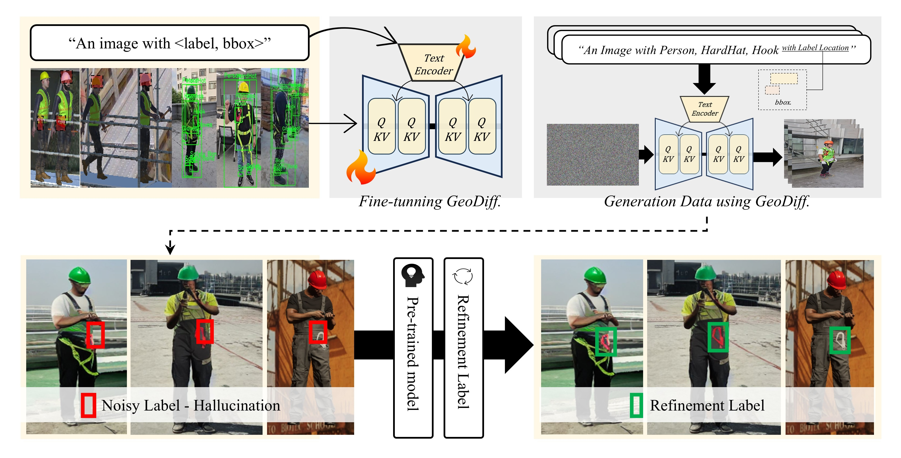

# Sim2Safe

Domain-adaptive Synthetic Data Generation for Construction Safety Monitoring Using Game Engine–diffusion Hybrid Pipeline

## Highlights

  

- We identified a major limitation in generating synthetic data using image Generative AI: the difficulty of producing target objects without domain-specific knowledge, and we demonstrate the potential of the proposed methodology for application in the construction safety domain.

- By combining a layout-to-image generation method with a label refinement algorithm, we propose a construction synthetic data generation methodology that minimizes the burden of manual labeling required by existing diffusion model-based approaches and examined its effectiveness.

## Environments

- python  version : 3.11.5
- pytorch version : 2.10.0+cu128
- GPU : A100*4EA

## Datasets

- will be soon ...

## Citations
```java
@article{
   will be announced ...
}
```

## Reference

- https://github.com/sunsmarterjie/yolov12
- https://github.com/KaiChen1998/GeoDiffusion